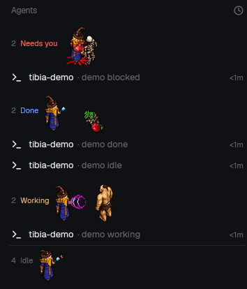

# Tibia Agents for Herdr

Herdr's Agents panel, with an animated Tibia scene for each agent status.



| Status | Scene |
| --- | --- |
| Needs you | The monster closes in; blood on the mage and the floor. |
| Done | The monster's corpse with a piece of loot on it. |
| Working | The mage casts a spell at a monster. |
| Idle | The mage dozes. |

The art is CipSoft's, taken from Tibia client files. Keep this repository
private, or remove `mods/agents-tibia/sprites/` **and its Git history** before
publishing it.

## Install or update

Needs Herdr (built against 0.1.18), started at least once, and `python3`. The
sprites are included. From this directory:

```sh
python3 install.py
herdr-app do layout.switch '{"name":"tibia"}'
```

The installer checks the mod, copies it to
`~/.config/herdr-app/mods/agents-tibia/`, and writes `layouts/tibia.json` from
your shipped `main` layout. It saves any mod and layout it replaces under
`~/.config/herdr-app/backups/`. Run it again after pulling changes or after a
Herdr upgrade.

`layouts/tibia.json` is rebuilt each time, so reapply any changes you made to
it. For another Herdr home, pass `--home`.

To go back: `herdr-app do layout.switch '{"name":"main"}'`.

## Customize

- **Character:** set the Herdr shared setting `tibia.outfit` to 128–134,
  136–142, or 144. The default is 130, the mage.
- **Monsters, spells, loot:** edit `fights.js` or `loot.js` in
  `mods/agents-tibia/`, regenerate the sprites, and run the installer.

## Regenerate the sprites

Needs Pillow, plus `Tibia.spr` and `Tibia.dat` of the extended 8.6 profile
(`cip860-extended`, from release `15.25.0a00a0` of
[tibia-client](https://github.com/dudantas/tibia-client/releases/latest)) in
`~/Documents/tibia-8.6/`:

```sh
python3 tools/dump-dat-860.py     # once per client version
python3 tools/tibia860.py         # writes mods/agents-tibia/sprites/
python3 install.py
```

For client files kept elsewhere, pass `--dat <path>/Tibia.dat` to the dump and
`--source <path>` to the generator. The generator also writes a contact sheet,
`preview-860.png`, beside the client files.

When changing the animations, keep `SPELL_STEPS` and `SLEEP_FRAMES` in
`main.js` equal to the number of frames the generator writes.
