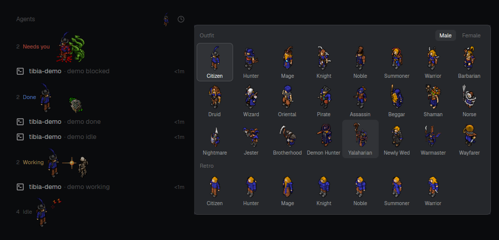

# Tibia Agents

Herdr's left sidebar Agents panel, where every agent status is a small Tibia
scene: the agent's character walking and casting at a fleeing monster while the
agent works, cornered when it needs you, standing over the loot when it is done,
and dozing before its first job. Every agent has its own character, in an order
you set, and any outfit can be recolored, from a picker dialog.

## What you see

The `tibia` layout is the shipped `main` layout with only the Agents block
replaced by this mod. Colors and type come from the active theme.

- **Header** (41 px): "Agents" at 11.5 px, dim; at the right, a 14 px sort icon.
- **Hovering a row** shows, before the pin button, the agent's character
  (20 px, "Trocar outfit e cores"), which opens the picker for that agent.
- **Priority view:** sections in the order Needs you, Done, Working, Idle, after
  Pinned when something is pinned. A section header is 76 px high: the agent
  count (dim), the section name in its status color, then one 96×64 scene. Rows
  below are 30 px: program icon, space name, dimmed detail, machine name for a
  remote agent, and time since the last change (`<1m`, `5m`, `2h`, `3d`).
- **Grouped by space:** space headers (34 px); agent rows 70 px high with their
  own 96×64 scene at the right; sub-agents as a tree beneath their parent.
- **Rail** (sidebar narrower than 160 px; 44 px, 76 on macOS): 26 px rows with
  the agent number and a 20×20 sprite, and a `»` button at the bottom.

## How it behaves

| Status | Panel (96×64) | Rail (20×20) |
| --- | --- | --- |
| Working | The character walks in place bottom-left facing east and casts at a monster bottom-right, which walks away in place facing east: two walking steps each, 250 ms apart. A missile flies in 5 frames, its hit effect shows in 4, 120 ms each, then 600 ms pause. | Character alternating its two walking steps, bobbing 1 px every 240 ms. |
| Needs you (blocked) | The character faces south on a blood splatter, the monster right beside. A blood burst plays on the character: 6 frames, 85 ms each, then 320 ms pause. | Character with the burst. |
| Done | Still: the character standing east, the monster's corpse where it stood, one loot item on the corpse. | Character beside the item. |
| Idle | The character standing east with Zzz beside its head: 7 frames, 220 ms each, then 660 ms pause. | Character facing south, still. |

- Done also covers an agent that went from working to idle while you watched it:
  Herdr turns `done` into `idle` as soon as you look, so the panel remembers the
  finish and keeps the Done scene until the agent works again. Idle (dozing)
  is for agents that have not finished anything yet.

- The monster is picked when an agent starts working and stays through Needs you
  and Done. The spell is picked per working stretch (a paladin's missile per
  shot), the loot per completion.
  Picks are random, independent, and stable across redraws; a panel reload picks
  anew.
- Vocations, one per outfit (shared `tibia.outfitVocations`, by looktype): an
  agent attacks with the vocation of the outfit it wears, else mixed. Mixed casts the 8 spells every agent cast before vocations (ice, holy burst,
  fire, energy, energy ball, sudden death, earth, small holy). Sorcerers cast
  fire, energy, energy ball or sudden death; druids ice, small ice, earth or
  poison; paladins shoot one of 24 arrows, bolts, spears, stars, knives or holy
  missiles each shot, and their first hit leaves blood under the monster.
  Knights don't walk in place: the monster stands still and the knight walks up,
  strikes it (blood spurts) and walks back. The palette's "automatic" command
  and the picker's "Automático" change which outfit an agent wears, not the
  outfits' vocations.
- 8 monsters (dragon, demon, cyclops, orc, giant spider, hydra, rotworm,
  skeleton) and 10 loot items (gold coins, violet gem, health potion,
  banana, fire sword, golden helmet, mastermind shield, backpack of holding,
  frozen starlight, thunder hammer).
- Agents showing the same status animate in step. Burst, spell, and sleep
  animations stop when not drawn or when the window is hidden.
- A priority header shows the scene of the first agent listed in its section
  with that status, so priority rows have no scenes of their own.
- Click a row to focus its pane; click a sub-agent without a pane to peek at it.
- Hover a row to get the character button and a pin button; pinned agents come
  first. In grouped rows (sub-agents too), clicking the scene also opens the
  picker for that agent.
- Click a header to fold its group. A row's chevron, or its program icon, folds
  its sub-agents.
- The sort icon opens a 200×140 popup: Priority or Grouped by space.
- **Outfits per agent.** Each agent and sub-agent wears one outfit. One picked
  for it by hand wins; otherwise it takes the first outfit of the agent order
  that no live agent wears, kept while it lives (past the order's end, outfits
  repeat). Changing the order hands the automatic outfits out again. The
  default order is Citizen, Mage, Summoner, Warrior, Hunter, Noble, Knight
  (male).
- **The picker** is an 880×470 dialog (labels in Portuguese). Its header has two
  tabs and a Masculino/Feminino toggle. On the left, a grid of 24 outfits (8
  columns, 60×62 cells, 42 px sprite and name), a "Retrô" label and one row of 7.
  Outfits: Citizen, Hunter, Mage, Knight, Noble, Summoner, Warrior, Barbarian,
  Druid, Wizard, Oriental, Pirate, Assassin, Beggar, Shaman, Norse, Nightmare,
  Jester, Brotherhood, Demon Hunter, Yalaharian, Newly Wed, Warmaster, Wayfarer.
  Retro: the first seven in their oldschool looks, which have no addons.
  - *Outfit tab:* the grid selects the outfit to look at. On the right: a
    256×128 preview (standing, then a walking step), four part buttons (Cabeça,
    Corpo, Pernas, Pés) with their color, and Tibia's 133-color outfit palette
    (19×7 swatches of 15 px; the current part's color outlined). Each click
    re-renders the preview, about a second, latest request wins. Buttons:
    *Automático* (only for an agent with an outfit picked by hand: back to the
    order), *Cores padrão* (the shared colors), *Cancelar*, *Salvar cores*
    (recolors that outfit for every agent wearing it; never changes what the
    agent wears) and, when opened for an agent on an outfit it doesn't wear,
    *Vestir este agente* (gives it the outfit, and saves changed colors).
  - *Ordem dos agentes tab:* the order as a list (place, sprite, name,
    looktype) with ↑, ↓ and ✕ per row; a grid click inserts that outfit after
    the selected row, or selects it if listed. Any outfits, any number, at least
    one. Buttons: *Ordem padrão*, *Cancelar*, *Salvar ordem*.
- Palette entries: "Tibia: outfits e cores" (the picker without an agent) and
  "Tibia: todos os agentes no automático" (drops every outfit picked by hand).
- A sub-agent without a pane counts `error` as blocked and `done` as idle.

## Built from

- Two mods. `agents-tibia` (`main.js`, `outfits.js`, `loot.js`, `fights.js`,
  `sprites/`), a modified copy of the shipped `agents` mod of Herdr 0.1.18. Its
  `mod.json` has `"place": "none"` and the palette entry for
  `agents-tibia.automatic` (handled with `nextCommand`). The layout puts it in
  the block with id `agents`. `tibia-picker` (`main.js`, `outfits.js`, a copy of
  the panel's, and `config.js`, written by `install.py` with the repo's path and
  Python) is the picker dialog, opened with props `{ agent, name, outfit }`, or
  none from the palette (`mod.open`). It sets the vocation of the outfit shown
  (any number of outfits before saving), kept when "Salvar alterações" (or
  "Vestir este agente") is clicked; "Cancelar" drops them.
- Props of `agents-tibia`: `{ sortMenu: true }` renders the sort popup; no props
  renders the panel.
- `herdr` functions: `agents`, `terminals`, `panes`, `focused`, `spaces`, `run`,
  `theme`, `shared`, `setShared`, `setAgentOrder`, `openOverlay`,
  `closeOverlay`, `props`, `window`, `layout`, `nextCommand`, `checking`; the
  picker also `exec`, `readTextFile`, `home`, `appHome`.
- Commands: `pane.focus`, `terminal.peek`, `terminal.pin`, `layout.resize`.
- State: shared `tibia.agentOutfits` (outfits picked by hand, by terminal
  address), `tibia.outfitVocations` (each outfit's vocation, by looktype),
  `tibia.agentOrder` (looktypes), `tibia.outfit` (optional: put first
  in the order), `agents.sort`, `sidebar.width`, `sidebar.collapsed`;
  `localStorage` `changed` (each agent's state, time, fight, and whether it
  finished), `outfits` and `outfitOrder` (the automatic handout), and `pins`.
- Icons come from the shipped `workspace-chrome` mod.
- The panel reaches no network and runs no programs. The picker runs
  `tools/recolor.py` with Python: previews go to `<Herdr home>/tibia-preview/`,
  outside `mods/`; saved colors rewrite that outfit's sprites in the installed
  mod and in the repo, and `cores.json` beside the client files.
  `install.py` and `tools/` run outside Herdr; the installer runs
  `herdr-app check`.
- Art: PNGs made by `tools/tibia860.py` from the extended Tibia 8.6 client. Each
  scene is a stack of full-size transparent layers: character
  (`<outfit>/walk-<step>.png`, `<outfit>/fight.png` or `<outfit>/cornered.png`),
  then `monsters/<looktype>-flee-<step>.png` and `spells/` (and `blood/` for
  paladins); for knights `blood/pool.png`, `monsters/<looktype>.png`, the
  character (`<outfit>/step1.png`, `step2.png` or `fight.png`, shifted right)
  and `blood/<step>.png`; or `cornered/` and
  `melee/`, or `corpses/` and `rewards/`, or `sleep/`. The rail walks on
  `<outfit>/working.png` and `working-2.png`.
- Outfits are shaded gold hair `#FFAA00`, indigo top `#3F3FCC`, brown trousers
  `#B46337`, gray boots `#737373`, with every addon layer, unless `cores.json`
  (written by the picker) gives the outfit, or all of them, other colors.

## Watch out

- The extended pack's outfit and monster sprites are stored rotated 45°; rotate
  them -45°. Sprite 0 of a frame is its bottom-right tile.
- Looktype 160 has no art in this pack.
- On macOS, images show thin edge lines. Draw the copies in `sprites/padded/`
  (3 px transparent border) clipped to size.
- Animate with one timer per animation that calls `notify`, and ask for a frame
  only when drawing it, so unused timers stop.
- Right after a reload, images can be blank until they load.
- `SPELL_STEPS`, `SLEEP_FRAMES` and `WALK_STEPS` in `main.js` must match the
  frames on disk.
- Writing any file under a mod's folder reloads that mod. That is why the
  picker is its own mod (saving colors rewrites the panel's sprites, which
  reloads the panel, not the open dialog) and why previews live outside
  `mods/`, each under a new name.
- Walking frames share one crop and scale per character and per monster, so
  the steps don't jitter.
- A mod's `close()` is called by Herdr when its overlay goes: the picker closes
  itself with another name.
- A picked outfit belongs to a terminal address: a new terminal starts on the
  order. Colors belong to the outfit, shared by every agent wearing it.
- Without the client files and `frames/`, the picker still switches outfits and
  edits the order, but can't preview or save colors.
- `install.py` expects the shipped `main` layout to have exactly one block with
  id `agents` showing the `agents` mod, and stops otherwise. Upstream changes to
  the shipped mod need merging into `main.js` by hand.
- The macOS rendering of the 96×64 scenes has not been verified.

## Done when

- `herdr-app check` passes on `mods/agents-tibia` and `mods/tibia-picker`.
- `python3 install.py` writes both mods and `layouts/tibia.json`, and
  `herdr-app status` shows no errors after switching to `tibia`.
- Agents reporting `working`, `blocked`, `done`, and `idle` (OSC 7501) show
  their four scenes in priority headers and in grouped rows; an agent that
  never worked dozes.
- An agent going from working to blocked or done keeps its monster; one you
  watch finish shows the Done scene.
- Several agents wear different outfits in the order's sequence.
- Without `cores.json`, `tools/tibia860.py` writes the same images as before
  the colors existed, and `tools/recolor.py --apply` writes an outfit's images
  byte for byte like the full run.
- The rail shows the 20 px sprites.
